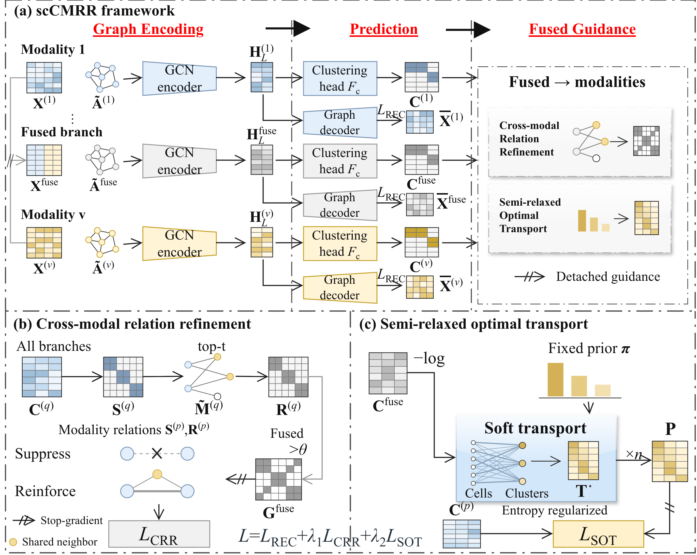

# scCMRR

**Cross-modal Neighborhood Refinement and Abundance-aware Clustering of Single-Cell Multi-Omics Data**

scCMRR integrates paired single-cell multi-omics measurements for cell clustering. It combines graph-based representation learning, cross-modal neighborhood refinement, and abundance-aware supervision through semi-relaxed optimal transport.

The framework contains modality-specific branches and a fused branch. The fused branch guides neighborhood refinement across modalities, while a data-derived cluster-abundance prior supports clustering with unequal population sizes.



## Requirements

The minimum package versions specified in [requirements.txt](requirements.txt) are:

| Package | Version requirement |
| --- | --- |
| NumPy | >= 1.24 |
| SciPy | >= 1.10 |
| scikit-learn | >= 1.2 |
| h5py | >= 3.8 |
| PyTorch | >= 2.0 |

Use a Python environment compatible with these dependencies. CPU execution is supported. To use an NVIDIA GPU, install a CUDA-compatible PyTorch build for your environment.

## Installation

Clone the repository and install the dependencies:

```bash
git clone https://github.com/kaiming-CMU/scCMRR.git
cd scCMRR

python -m venv .venv
source .venv/bin/activate
python -m pip install -r requirements.txt
```

On Windows PowerShell, replace the activation command with:

```powershell
.venv\Scripts\Activate.ps1
```

Run the following commands from the repository root.

## Quick start

The default configuration uses the included `data/GSE100866.h5` file:

```bash
python train.py --config config.json
```

By default, training runs for 200 epochs and writes results to `results/`. The `auto` device setting uses CUDA when available and otherwise uses the CPU.

To choose a device and output directory explicitly:

```bash
# CPU
python train.py --config config.json --device cpu --output results/GSE100866

# CUDA GPU
python train.py --config config.json --device cuda --output results/GSE100866
```

The command-line interface supports the following options:

| Option | Description |
| --- | --- |
| `--config` | Path to a JSON configuration file; defaults to the `config.json` beside `train.py`. |
| `--epochs` | Override the number of training epochs. |
| `--device` | Override the device, for example `auto`, `cpu`, or `cuda`. |
| `--output` | Override the output directory. |

## Data

### Included example

The repository includes an HDF5 example named [GSE100866.h5](data/GSE100866.h5). The corresponding public CITE-seq study is available under GEO accession [GSE100866](https://www.ncbi.nlm.nih.gov/geo/query/acc.cgi?acc=GSE100866).

The default configuration reads two modalities and a reference-label array:

| HDF5 key | Interpretation in the default configuration |
| --- | --- |
| `X1` | RNA feature matrix, with cells in rows and features in columns. |
| `X2` | Protein feature matrix, with cells in rows and features in columns. |
| `Y` | Reference cell labels. |

### Input format

Input files must contain at least two modalities measured on the same cells, with the same row order in every modality. Each matrix must have finite, nonnegative values and at least one variable feature.

The loader supports:

- Dense HDF5 datasets containing cell-by-feature matrices.
- Sparse CSR or CSC groups containing `data`, `indices`, and `indptr`, together with a `shape` attribute. Set the `encoding-type` or `format` attribute to identify CSR or CSC storage; CSR is the default when neither attribute is present.
